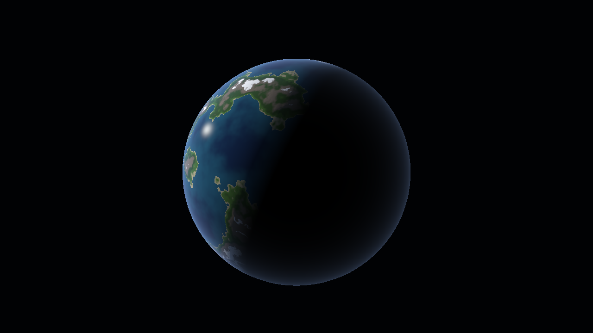
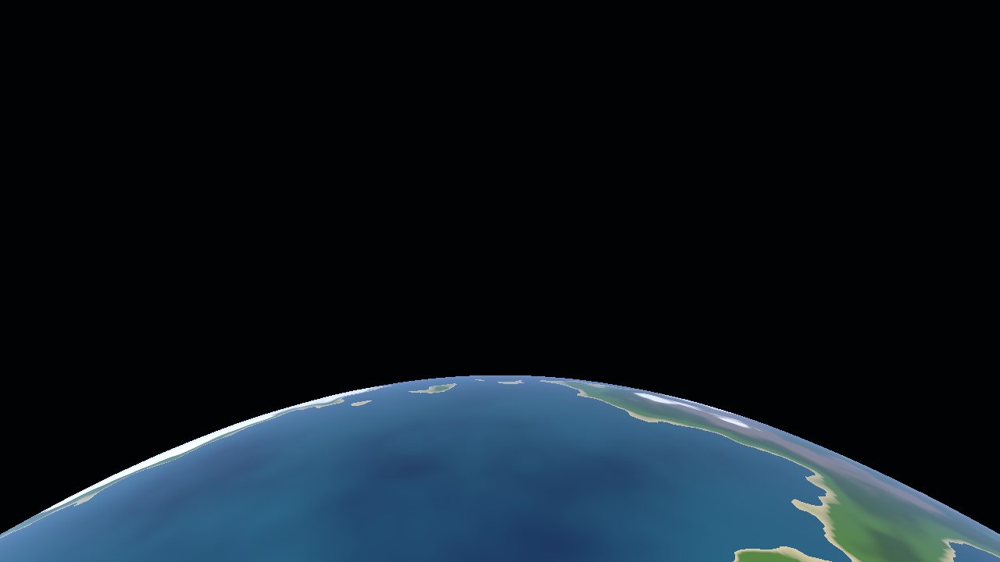

# Orbis — planet-scale terrain renderer

A whole-planet terrain renderer in modern C++20 and OpenGL 4.5, built around the problems that
real geospatial and military simulators have to solve: **planetary coordinate precision,
geodetically correct coordinates (WGS84), depth precision from the ground to orbit, and seamless
terrain on a sphere.**


| Day/night terminator | Oblique view from 1500 km |
|---|---|
|  |  |

*Frames rendered headless in CI with Mesa's software OpenGL (llvmpipe).*

## Highlights

**Camera-relative rendering.** A 32-bit float has only ~7 significant digits: at Earth-radius
distances (6.4·10⁶ m) its resolution is ~0.5 m, which shows up as vertices shaking when the camera
moves. All world positions are kept in `double` (ECEF), each terrain chunk stores its vertices in
`float` *relative to its own origin*, and per frame the CPU computes `chunkOrigin − cameraPosition`
in double. The GPU therefore only ever sees small numbers. A unit test demonstrates both the
problem and the fix.

**Reversed-Z with an infinite far plane.** A single depth buffer covers everything from 0.5 m to
infinity: `glClipControl(GL_ZERO_TO_ONE)` + 32-bit float depth + a projection that maps the near
plane to 1 and infinity to 0, so the non-linear 1/z distribution and float's density near zero
cancel out. No z-fighting, no near/far plane tuning, no logarithmic-depth hacks.

**WGS84 geodesy.** Exact geodetic → ECEF conversion and an iterative ECEF → geodetic inverse that
is stable at the poles (round-trip error < 1 mm over 20 000 random points from −11 km to 10 000 km
altitude). Local East-North-Up frames, ellipsoid surface normals, terrain displaced along the
geodetic vertical — the same conventions GPS uses.

**Spherified cube.** The planet is a cube inflated onto the ellipsoid: no pole singularities, and
every face can be subdivided as a quadtree (next stage). The mapping keeps cell areas within 4/3 (1.33×)
of each other instead of ~5.2× for naive normalisation, and shared face edges are bit-identical
(tested), so there are no cracks.

**Seamless lighting.** Normals are computed from the height field around each vertex's *direction*,
not from neighbouring grid vertices, so chunks that share a border compute bit-identical normals
and there are no lighting seams.

**Deterministic procedural terrain.** 3D Perlin fBm with ridged mountains, sampled on the unit
sphere (no pole stretching, no date-line seam). The permutation table uses its own SplitMix64 +
Fisher–Yates instead of `std::shuffle`, so a seed produces bit-identical terrain on MSVC, GCC and
Clang — a prerequisite for networked or replayed simulation.

**Horizon-stable flight camera.** Heading and pitch are stored relative to the local ENU frame,
so "up" is always away from the ground; the view direction is parallel-transported between frames,
so flying over a pole does not flip the camera. Speed scales with altitude.

**Engineering.**
- Engine core (`orbis_core`) has no OpenGL or windowing dependency and is fully unit-tested.
- 33 Catch2 tests: math, projection, geodesy, cube-sphere seams, noise determinism, mesh winding,
  float-precision bounds, camera behaviour over the poles.
- CI on Windows (MSVC) and Linux (GCC), Debug and Release, warnings as errors
  (`/W4`, `-Wall -Wextra -Wpedantic -Wconversion -Wsign-conversion -Wdouble-promotion ...`),
  ASan + UBSan, and a headless render smoke test that uploads frames as artifacts.
- Dependencies pinned by version **and** SHA-256; shaders embedded at build time.
- Modern OpenGL: Direct State Access, immutable buffer storage, RAII ownership of every GL object,
  `KHR_debug` output in debug builds.

## Building

Requirements: CMake ≥ 3.25, a C++20 compiler (MSVC 2022, GCC 12+, Clang 15+), a GPU with
OpenGL 4.5. macOS is not supported (Apple stops at OpenGL 4.1).

```bash
# Windows (Developer PowerShell for VS 2022) or Linux
cmake --preset release
cmake --build --preset release
ctest --preset release
```

On Linux install the X11 headers first:
`sudo apt install libx11-dev libxrandr-dev libxinerama-dev libxcursor-dev libxi-dev`.
In Visual Studio you can also just *Open Folder* — the presets are picked up automatically.

## Running

```
orbis [--size WxH] [--view lat,lon,altKm,heading,pitch] [--screenshot file.ppm]
```

| Input | Action |
|---|---|
| Right mouse + move | Look around |
| W A S D | Fly |
| Space / E, Ctrl / Q | Up / down along the local vertical |
| Shift | 4× speed |
| Mouse wheel | Speed multiplier |
| F1 | Wireframe |
| Esc | Quit |

The window title shows FPS, altitude and geodetic position.

## Project layout

```
src/core/      engine core, no GPU dependency
  math/        Vec3, Mat4 (reversed-Z projection)
  geo/         WGS84 ellipsoid, geodetic <-> ECEF, ENU frames
  terrain/     cube-sphere mapping, Perlin noise, height field, chunk mesh generation
  scene/       ENU flight camera
src/app/       window, OpenGL renderer, application loop
shaders/       GLSL, embedded into the executable at build time
tests/         Catch2 unit tests
```

## Roadmap

- [x] **Stage 1 — foundation:** WGS84, cube-sphere, camera-relative rendering, reversed-Z,
      procedural terrain, tests, CI.
- [ ] **Stage 2 — LOD:** per-face quadtree with screen-space-error refinement, frustum and horizon
      culling, crack-free LOD transitions (skirts).
- [ ] **Stage 3 — streaming:** worker-thread job system for tile generation, GPU upload budget,
      tile cache with LRU eviction.
- [ ] **Stage 4 — real data:** SRTM elevation tiles, ImGui debug panel, atmospheric scattering.

## References

- NIMA TR8350.2 — *Department of Defense World Geodetic System 1984*.
- P. Cozzi, K. Ring — *3D Engine Design for Virtual Globes* (2011).
- K. Perlin — *Improving Noise* (SIGGRAPH 2002).
- E. Persson — *Depth in-depth* / N. Reed — *Depth Precision Visualized* (reversed-Z).
