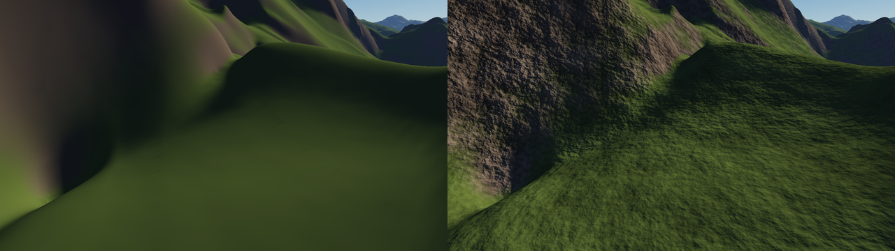
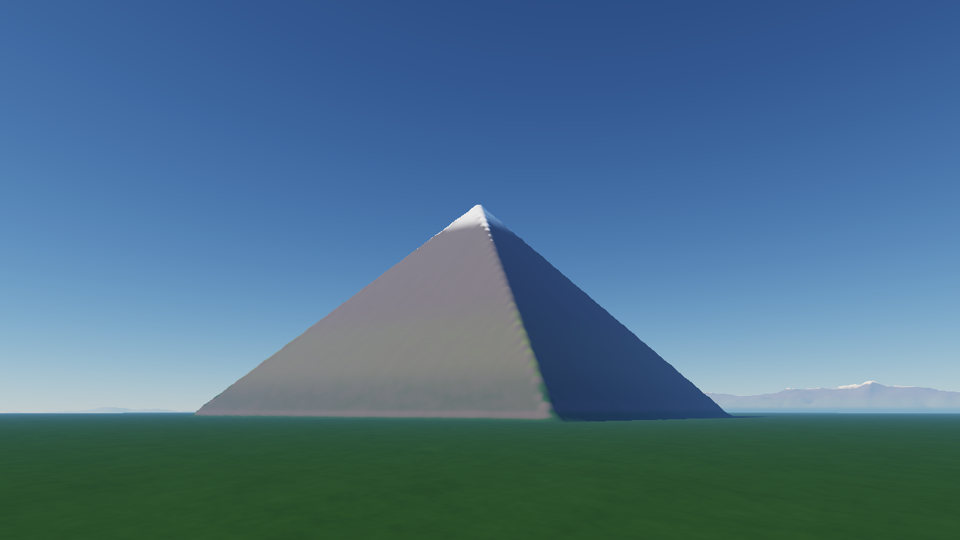

# Orbis — planet-scale terrain renderer

A whole-planet terrain renderer in modern C++20 and OpenGL 4.5, built around the problems real
geospatial and military simulators have to solve: **real Earth elevation data on a WGS84 ellipsoid,
planetary coordinate precision, continuous level of detail from orbit to the ground, culling at
planetary scale, and streaming terrain generation on worker threads.**


| The Alpine arc from 70 km (real data + synthetic detail) | An Alpine valley, looking up 2.6 km of relief |
|---|---|
|  |  |

| Procedural planet (`--world procedural`) | Quadtree LOD levels (debug view, F3) |
|---|---|
|  |  |

| Volumetric cumulus, lit by the same atmosphere | Above the cloud layer: cloud shadows on real land cover |
|---|---|
|  |  |

| Sunset: colours from physics, not from a palette | Debug panel |
|---|---|
|  |  |

*All frames rendered headless in CI with Mesa's software OpenGL (llvmpipe).*

## Highlights

### Real Earth

**Measured elevation.** NOAA ETOPO1 (ice surface, 10 arc-minutes ≈ 18 km), converted by
`tools/prepare_etopo.py` into a 4.7 MB grid that ships with the repository. The converter verifies
the source by SHA-256 and recovers the grid layout from the point coordinates instead of assuming
it — the source turned out to start at Greenwich, not at −180°, which a check against known
places (Everest, Mariana Trench, Košice, the Netherlands' polders below sea level) caught.

**Sampling done properly.** Bicubic (Catmull-Rom) interpolation, because bilinear is only C0 and
every grid line would show as a lighting crease below the data resolution. A low-passed mip
pyramid so coarse LOD levels read pre-filtered data instead of aliasing. Rows beyond a pole
continue on the opposite meridian and longitude wraps, so the poles and the date line are not edges.

**Synthetic detail below the data resolution** — the standard simulator approach of "measured base,
plausible detail". The detail starts exactly at the data's Nyquist limit, and its strength comes
from a precomputed *relief map* (how much the data deviates from its own smoothed version): ~5 m on
plains, ~300 m in the Tatras, ~700 m in the Alps. Absolute height would be a poor guide — the
Tibetan plateau is high but flat. Where the data says land, detail may not create sea (otherwise
every lowland fills with puddles); the other way round gives natural fractal coastlines.

**One interface, two worlds.** Quadtree, mesh builder and worker threads only see
`ElevationSource`; `--world earth|procedural` switches between ETOPO and the procedural planet.

*Honest limits:* 18 km data shows real mountain ranges from altitude, but foothills rather than
peaks from the ground — that needs higher-resolution tiles (see below).

### Real land cover

**Measured, not guessed.** The colours of the land come from the MODIS land cover map (MCD12C1,
2019: the majority IGBP class of every 0.05° ≈ 5.6 km cell — forests by leaf type, shrubland,
savanna, grassland, cropland, wetlands, cities, deserts, ice). It replaces a stylisation by
latitude that turned monsoon Nepal into a desert and every plain into one green.

- `tools/prepare_landcover.py` (standard library only — its own 60-line TIFF reader) verifies the
  source by SHA-256, **checks the georeferencing instead of assuming it**, and writes 26 M cells as
  a 2.0 MB run-length file with a checksum; the loader rejects truncated or corrupt files with a
  message (tested).
- **The sea is not a lake.** MODIS has one "water" class for both. Orbis labels the connected
  components of water cells at load time: a component touching water deeper than 50 m in the
  elevation data is sea, the rest (181 000 cells: Lake Geneva, Victoria, the Finnish lakes ...)
  becomes *inland water*. The ocean itself is drawn from the elevation, so a coastal cell that is
  half land does not paint its land half blue. Labelling the components first means the whole
  ocean costs a handful of elevation samples; only lakes are sampled cell by cell.
- **Categories are never interpolated** — the average of "forest" and "desert" is not a class. The
  GPU gets the classes as an integer texture; the shader fetches the 4 cells around each fragment,
  blends their *materials*, and domain-warps the lookup with four octaves of noise (25 km down to
  400 m), so the 5.6 km grid turns into frayed, natural boundaries instead of a staircase.


*Northern Italy and the Alps from 600 km: the latitude stylisation (left) and MODIS land cover
(right) — Po valley farmland, Alpine forest, the Apennines.*

- What 5.6 km cannot resolve stays rule-based: the altitudinal zones of mountains (meadow above
  the tree line, bare rock, the latitude-fitted snow line), rock on every cliff, a beach only where
  the data says the sea is near (the Netherlands are below 8 m but are not a beach), polar
  "barren" as frost-shattered rock rather than sand. `--no-landcover` (or the debug panel) shows
  the old stylisation for comparison.
- A side effect found while checking the first frames: inland "beaches" all over the Alpine
  foothills. Synthetic relief can push a valley below sea level, and a hard `max(h, 0.5 m)` cut
  those valleys into flat terraces that the shader coloured as sand. Downward offsets are now
  compressed exponentially towards the floor — unchanged for small offsets, never reaching it,
  C1-smooth.

### Making mountains feel big

Mountains first looked small and soft. Instead of tuning by eye, the problem was **measured**:
the share of the area steeper than 30° in a 20 km square, sampled every 30 m.

| | before | after | reality |
|---|---|---|---|
| Valais Alps, > 30° | **0 %** | 38 % | Valais is among the steepest parts of the Alps |
| Valais Alps, relief | 0.9 km | 3.1 km | ~3 km |
| High Tatras, highest point | — | 2725 m | Gerlachovský štít 2655 m |

The causes, and what fixed them:
- **The synthetic relief sat at the wrong scale.** Its longest ridges had an 18 km wavelength;
  real peaks stand 3–8 km apart. Rebuilt at 8 km with **eroded fBm** (I. Quilez): each octave is
  damped by the slope accumulated so far, which gives clean steep flanks, sharp crests and flat
  valley floors. It needs Perlin noise with an **analytic gradient** — tested against finite
  differences to 10⁻⁶.
- **Its amplitude was 5× smaller than intended.** Measuring the layers showed a standard
  deviation of 0.09 instead of the assumed ~0.5, and the ridged layer had a mean of 0.51, so it
  lifted terrain instead of adding relief. Both are now normalised to mean 0 / std 1 by measured
  constants, which a test re-measures.
- **No shadows.** Cascaded shadow maps (3 × 2048², camera-relative): splits scale with height
  above the ground; each map extends 150 km towards the sun so mountains outside the view still
  cast their long evening shadows into it; centres are snapped to whole texels in *world*
  (double, ECEF) coordinates so edges do not crawl; the depth pass reuses the terrain vertex
  shader, geomorphing included, so the surface cannot shadow itself.
- **A wide-angle lens.** 60° vertical FOV visibly shrinks distant mountains; now 45° (adjustable),
  and `--above-ground` puts the camera in a valley looking *up*.
- The camera is now kept above the **terrain**, not just above sea level.


*Low sun (9°), without and with cast shadows.*

### Surface materials: no more clay

Close to the ground the terrain used to look smooth and "clay-like": one colour per material and
the mesh's own normals. Now every pixel gets detail at four world scales (256 m, 32 m, 4 m,
0.5 m), from **one** 512² tiling noise texture:

- **Generated and tested on the CPU** (`core/terrain/DetailNoise`): periodic gradient noise whose
  lattice wraps, so the texture tiles seamlessly (a test checks the seam is no steeper than any
  other step); height normalised to mean 0 / std 1 by measurement; **analytic derivatives** stored
  next to the height (tested against finite differences to 10⁻⁵). Because a mip level is a linear
  average, averaging derivatives gives exactly the derivative of the averaged height — distant
  bumps flatten out correctly instead of sparkling.
- **World-anchored detail with small floats.** The texture must stick to the ground, but world
  coordinates are ~6·10⁶ m. The shader uses `cameraRelative + (camera mod 256 m)` — the modulo
  computed in double on the CPU. When the camera crosses a multiple of 256 m the coordinate jumps
  by exactly one period, which is invisible because every tile size divides it.
- **Triplanar** projection (cliffs are not stretched) and **bump mapping** specified as *slopes*
  (std of the added slope per scale, e.g. 17° for rock at 32 m), not heights: the finest octaves
  dominate a gradient, so heights would make the look depend on the octave count. A bump cannot
  light a face the geometry turns away from the sun.
- **Material blending with noise:** the rock-on-cliffs slope threshold, the tree, rock and snow
  lines, beaches and lake shores are all frayed by the same multi-scale noise, so a snow line is
  never a contour line. Rock bumps hard, grass and soil less, snow and sand least.
- **Albedo variation:** log-normal brightness and dryness changes break up large uniform areas.
  The broadest layer (~3 km) is noise on the sphere, not the texture: seen from 70 km, a 256 m
  repetition showed up as a regular grid — so was each scale before it was faded out while one tile
  still spans ~20 pixels.



*An Alpine meadow below a cliff, 30 m above the ground: without and with surface detail.*

Measured on ground-level frames (lower half, mean luminance standard deviation inside 8×8 pixel
blocks): **11×** more local contrast in an Alpine meadow, **6×** on procedural rock. `--no-detail`
and the debug panel switch it off for comparison.

### Real mountains: high-resolution tiles

Steeper synthetic relief makes mountains *look* right, but it cannot make the Alps *be* the Alps.
What makes them feel enormous are specific walls: 3–4 km of rock rising within a few kilometres.
Checked against the real heights:

| | real | Orbis (18 km data + synthetic detail) |
|---|---|---|
| Matterhorn | 4478 m | 1688 m |
| Mont Blanc above Chamonix | 3773 m of relief | 1608 m |
| Eiger north face above Grindelwald | 2933 m | **−5 m** |

The 18 km grid averages each peak with its valley; the synthetic detail has the right statistics
in the wrong places. The fix is real data, so Orbis reads **SRTM `.hgt` tiles** (1° × 1°,
big-endian int16, 90 m or 30 m — e.g. the void-filled Alpine DEMs of viewfinderpanoramas.org):

- `ElevationGrid` gained a regional topology (clamped edges) next to the global one (wrapping
  longitude, pole reflection), sharing the tested bicubic sampling and pyramid code. Voids are
  NaN, never invented values.
- Inside the tiles the real relief replaces the base data and its synthetic mountains; only a few
  metres of detail below the tile resolution remain synthetic.
- `orbis --check-alps` prints famous summits and valleys, real vs rendered — the quickest way to
  verify the tiles were found and oriented correctly. See [data/HGT_README.md](data/HGT_README.md).

**Streamed on demand, for the whole planet.** The first version stitched every tile in
`data/hgt/` into one mosaic at startup — fine for the Alps, impossible for a continent. Now the
folder is only *indexed* (names and sizes) and tiles are loaded around the camera, under a
memory budget (`--tile-budget MB`, default 1.5 GB), so it may hold the 14 000 tiles of global
SRTM:

- **Demand comes from the terrain itself.** When a mesh worker samples a fine LOD level inside a
  tile that is on disk but not loaded, the sample records a request — one relaxed atomic store —
  and returns "no data"; the chunk is built from the base terrain for now. A loader thread reads
  the most recently requested tile, builds its mip pyramid and **publishes** it: an immutable
  snapshot of the loaded set is swapped in (copy-on-write), so readers never lock and never see a
  half-built tile. Each worker thread caches the snapshot and re-reads it only when the version
  counter changes: the hot path costs one atomic load, not a lock or a contended reference count.
- **Stale meshes are rebuilt, not dropped.** Every publish increments a version; each mesh
  records the version it was built from (read *before* building, so a tile arriving mid-build
  counts as missing). The renderer invalidates the chunks over a changed tile — and over the
  feather band of its neighbours, whose blend towards it changed too — and keeps drawing them
  until the rebuilt mesh arrives: data sharpens in place, the image never has holes.
- **Coarse levels never depend on streaming.** Tiles are used only by samples finer than 400 m
  (fading out by 800 m), so the planet seen from altitude is identical whatever happens to be
  loaded, and only the fine chunks near the camera are ever rebuilt.
- **Blending** fades towards every neighbouring square that is *not loaded* (or not on disk),
  towards voids, and with sample spacing; neighbouring loaded tiles join without a seam (tested
  at a four-tile corner). 3″ and 1″ tiles may now be mixed.
- **Eviction** is least-recently-used, but only of tiles unused for the last 120 frames, and
  only to make room for the most wanted pending tile — a full budget would otherwise never admit
  a new one, however far the camera flew. Two bugs the tests caught: requests that arrived while
  their tile was loading brought it straight back after a later eviction, and an in-flight tile
  counted as "pending" made room for itself twice.
- Tests: demand loading, coarse samples ignoring tiles, seams, LRU order under a budget for two
  tiles while "flying" east across four, and four threads sampling while tiles stream in and out
  (no garbage values — and ThreadSanitizer in CI).

Tests write synthetic tiles whose height is a known function of latitude and longitude, so a
swapped axis, a mirrored tile, the wrong byte order or a seam would all give wrong numbers.



*Integration test frame: a synthetic 4478 m pyramid written as real `.hgt` tiles at the
Matterhorn's coordinates, seen from Zermatt. With real tiles, the real Matterhorn stands there.*

### Level of detail

**Chunked quadtree LOD with screen-space error.** Each of the 6 cube faces is a quadtree, down to
level 18 (~1.2 m between vertices). A node is refined when its vertex spacing, projected onto the
screen at the node's nearest point, exceeds a pixel budget (default 4 px, `[` / `]` to change). The
result: ~200 k triangles for the whole planet from orbit, ~2 M triangles at ground level with
detail from the foreground to the horizon.

**Selection is a pure function** of the view and of which chunks are resident — no hidden state,
fully unit-tested. If the children of a node are not ready yet, the coarser node keeps being drawn
and the children are requested: the image never has holes, it sharpens as data arrives.

**Tight bounds.** Culling needs bounding volumes *before* a mesh exists. Bounds start conservative
(0 – 11 km of terrain) and tighten to the real height range of each mesh once it is built; a
not-yet-built child inherits its parent's *subtree* range. Tests check these bounds against real
meshes. (Loose bounds were caught by a test: they inflated a ground-level view from ~1 000 to
~24 000 chunks.)

**Frustum culling + exact ellipsoid horizon culling.** The horizon test runs in ellipsoid-scaled
space, where WGS84 becomes the unit sphere and lines of sight stay straight, so the horizon is the
real one — an inscribed sphere would be 21 km too small at the equator and keep hundreds of
invisible chunks alive.

**Skirts against LOD cracks.** Neighbouring chunks at different levels do not share vertices; each
chunk has a skirt hanging below its border, wound to face outwards, so a crack shows terrain-coloured
skirt instead of sky.

**Geomorphing: no popping.** Every vertex also stores where it would lie on its *parent's*
surface (even vertices are parent vertices; the others lie on a parent edge or on the diagonal the
parent's triangulation uses). The vertex shader blends the two by distance, in a window that ends
just before the parent's split distance and starts after the chunk's own split distance — so a new
chunk appears looking exactly like its parent and grows its detail as the camera approaches, and
its own children later start from its full-detail surface. The blend depends only on vertex
*position*, so neighbours agree on shared vertices and no crack opens mid-transition. A test
builds a real parent mesh and checks that a fully morphed child coincides with it vertex by vertex.

**Measured, not eyeballed.** `--record N,metres --record-lod-only` keeps the view fixed and moves
only the LOD camera, so every change between frames comes from LOD transitions alone. Over a
30-frame pull-back above procedural mountains, pixels that jump by more than 25 levels drop from
0.127 % to 0.021 % per frame on average (**6×**) and **19×** in the worst frame. (The first version
of the experiment moved the LOD camera *forward* — then frustum culling around the fixed view
dominated everything; moving it backwards keeps the view inside the LOD frustum.)


*Change between two consecutive frames at the worst LOD transition: without geomorphing (left) a
whole chunk pops, with it (right) only small, gradual changes remain.*

Vertices are 40 bytes: normals are packed into `GL_INT_2_10_10_10_REV` (~0.1° precision) so the
second set of attributes costs 12 bytes instead of 24.

### Streaming

**Background mesh generation.** A thread pool builds chunk meshes; the main thread only uploads
finished ones (bounded per frame, no hitches). The request queue is *replaced* every frame rather
than appended to: requests the moving camera no longer needs are dropped before anyone wastes time
on them, the rest is re-prioritised by screen-space error. Shutdown is immediate even with
thousands of queued requests (a test caught it draining the whole queue first).

**GPU chunk cache** with time-based and LRU eviction (bounded memory; chunks drawn this frame are
never evicted).

### Precision and geodesy

**Camera-relative rendering.** A 32-bit float has ~7 significant digits: at Earth-radius distances
its resolution is ~0.5 m, which shows up as shaking vertices. World positions stay in `double`
(ECEF); each chunk stores `float` vertices relative to its own origin; per frame the CPU computes
`chunkOrigin − cameraPosition` in double. The GPU only ever sees small numbers.

**Reversed-Z with an infinite far plane.** One depth buffer from 0.5 m to infinity:
`glClipControl(GL_ZERO_TO_ONE)` + 32-bit float depth + a projection mapping near → 1, ∞ → 0.

**WGS84.** Exact geodetic → ECEF, an iterative inverse stable at the poles (< 1 mm round-trip error
from −11 km to 10 000 km altitude), ENU frames, terrain displaced along the geodetic vertical.

### Terrain

**Spherified cube** (cell areas within 4/3 of each other instead of 5.2× for naive normalisation;
face edges bit-identical, tested). **Procedural planet**: band-limited continents, ridged-multifractal
mountain ranges and fractal detail down to ~1 m, sampled on the unit sphere (no pole stretching, no
date-line seam). Octaves finer than a chunk can represent are faded out (Nyquist), so coarse levels
do not alias, and the normalisation keeps the large-scale shape identical across levels.
**Deterministic** across compilers (own PRNG instead of `std::shuffle`). **Seamless normals**
computed from the height field around each vertex's direction, bit-identical across chunk borders.

### Debug panel

Dear ImGui (immediate mode: the panel is re-described from the live state every frame, so it can
never show stale values). Frame-time graph, camera position, jump-to presets (Europe, Alps, Tatras,
Himalaya, Andes), LOD statistics and controls (pixel error, max level, geomorphing, LOD colours,
wireframe, freeze), and the sun's local azimuth / elevation. Input over the panel is not passed to
the camera. `F4` hides it.

### Physically based atmosphere

After S. Hillaire, *A Scalable and Production Ready Sky and Atmosphere Rendering Technique*
(EGSR 2020) — the approach used by Unreal Engine. Rayleigh scattering (air molecules), Mie
scattering (aerosols, Cornette-Shanks phase) and ozone absorption with physical coefficients. Two
lookup tables are computed once at startup by **compute shaders** (a third, the sky irradiance,
is described below): transmittance (Bruneton's
parameterisation, texels concentrated near the horizon) and Hillaire's multiple-scattering
approximation (second-order light over 64 directions, higher orders as a geometric series). Per
frame, every sky pixel and every terrain fragment integrates in-scattering along its view ray
(analytically per step, so few steps stay energy-conserving). The blue sky, the pale horizon,
the red low sun, orange light on the mountains at dusk, the planet's glowing limb and the haze
that makes distant ranges fade into exactly the sky colour behind them all *emerge* from the
same integral — none of them is painted.

- **Single source of truth.** The physical constants live in one C++ struct; the GLSL constants
  are generated from it, so CPU tests and GPU shaders cannot drift apart. Unit tests check the CPU
  model against the closed-form optical depth (to 10⁻⁴) and that the horizon sun is red.
- **GPU validated against CPU at startup.** The transmittance table is read back and compared
  with the C++ reference: the largest difference is 5·10⁻⁴, i.e. half-float precision.
- **WGS84 in a spherical model.** Atmosphere models assume a sphere; scaling z by a/b maps the
  ellipsoid onto one (the same trick as the horizon culling), so altitudes stay correct to 0.3 %.
- Sun light reaching each surface point is dimmed and reddened by the air above it and softly
  cut by the planet's shadow (mountain tops keep the light after the valleys lose it).
- **Sky irradiance table** for the ambient light, replacing a twilight-scaled constant: a third
  compute pass integrates the sky over the hemisphere for every altitude and sun angle
  (64 × 16 texels, 256 cosine-weighted directions × 32 steps each, single + multiple
  scattering). The light in the shadows is now blue at noon and violet after sunset because the
  sky is; a tilted surface sees `(1 + n·up) / 2` of the sky and the sunlit ground for the rest,
  and the hollows of the surface detail see less of it.
- **Validated like the transmittance table.** There is no cheap CPU twin for multiple scattering,
  so the GPU first builds the table with *single* scattering only and compares it with a C++
  reference (`skyIrradianceSingleScattering`, same directions, same steps): the largest
  difference is < 0.01 % of the maximum. CPU tests check that the phase functions integrate to
  one, that the sky is blue and gives a plausible 3–25 % of the direct light at noon, that it
  fades monotonically through dusk and is near zero 12° after sunset, and that the sample counts
  are converged — rays near the horizon carry the most light; 8 zenith strata were 3.5 % short,
  16 are within 2 %. Multiple scattering then adds ~70 % at noon.

### Volumetric clouds

A layer of cumulus between 2 and 5 km, ray-marched per pixel over the HDR scene and lit by the
same atmosphere, so a sunset turns its edges orange and the noon sky makes its shadows blue.

- **Density = weather × height profile × shape.** The weather is a 6 × 512² cube map of
  cloudiness, generated on the CPU from noise on the sphere (domain-warped into fronts and
  swirls) plus a **zonal climatology**: the cloudy tropical convergence zone, the clear
  subtropical highs, the stormy mid-latitudes (tested: the storm tracks come out clearly
  cloudier than the subtropics). The shapes come from a tiling 3D Perlin-Worley texture built by a
  compute shader at startup, eroded by finer Worley octaves — wispy at the base, billowy on top.
  A cube map because every direction then gets equally sized texels: no poles.
- **Lighting:** a short light march towards the sun per sample (Beer-Lambert through the cloud
  above), sunlight through the atmosphere from the transmittance table, a two-lobe
  Henyey-Greenstein phase (silver lining + back-scatter glow), three octaves of approximate
  multiple scattering (Wrenninge; Hillaire / Frostbite), a "powder" term, and ambient light from
  the **sky irradiance table** above plus the sunlit ground below — which is what keeps cumulus
  bases grey instead of navy.
- **Aerial perspective, exactly.** The scene behind a cloud already contains the haze of the
  whole ray. For a cloud of transmittance *Tc* and luminance *Lc* at an effective depth *d*,
  the correct result reduces to `scene · Tc + [T(0,d) · Lc + (1 − Tc) · S(0,d)]` — one blend
  (`GL_ONE, GL_SRC_ALPHA`) with the haze in front of the cloud integrated in the cloud pass.
  That needed an **HDR pipeline**: sky, terrain and clouds now write linear radiance into an
  RGBA16F target, and tone mapping is a final pass (it used to happen inside each shader, which
  makes any compositing wrong).
- **Expected values far away.** Once the shapes shrink below a pixel, thresholding their
  mip-filtered *average* turned every cloudy region seen from orbit into one opaque sheet. A broken
  field that covers half the sky lets half the light through, while the same water spread evenly
  would be opaque (Jensen's inequality, in clouds), so the far density is chosen to give the
  field's transmittance, `1 − cloud fraction`, across the layer.
- **World-anchored with small floats**, like the surface detail: the eye position is passed
  modulo the noise period (computed in double), and the three noise scales (60, 12, 1.5 km) must
  divide each other — the parameter struct refuses anything else (tested). The coarsest scale
  exists to break up the repetition of the 12 km shapes, which showed as a regular lattice of
  clouds from 70 km.
- **Cloud shadows** on the terrain from a few samples through the layer along the sun ray, with
  a floor: multiple scattering lets far more light through a cloud than Beer-Lambert alone.
- Geometry first: a `CloudParameters` struct generates the GLSL constants, and the ray-shell
  intersection (up to two intervals: a ray from space can dip below the cloud base and climb out
  again) has a C++ twin with tests for every case. `--clouds 0..1` sets the coverage,
  `--no-clouds` switches them off.

ACES filmic tone mapping turns the HDR result into display values.

### Engineering

- `orbis_core` has no OpenGL or windowing dependency: math, geodesy, terrain, LOD, land cover,
  tile streaming, the cloud model and the thread pool are all unit-tested — **106 Catch2 tests**,
  ~545 000 assertions, including checks against known geography and land cover, real-world slope
  statistics, `.hgt` orientation, stitching and streaming under concurrency, parent/child
  geomorph consistency, the analytic atmosphere and the sky irradiance reference.
- CI: Windows (MSVC) + Linux (GCC), Debug + Release, warnings as errors
  (`/W4`, `-Wall -Wextra -Wpedantic -Wconversion -Wsign-conversion -Wdouble-promotion ...`),
  **AddressSanitizer + UBSan**, **ThreadSanitizer**, and a headless render job that uploads frames.
- Dependencies pinned by version **and** SHA-256; shaders embedded at build time, shared GLSL with
  `#line` so compiler errors point at the right line.
- Modern OpenGL: Direct State Access, immutable storage, compute shaders, RAII ownership of every
  GL object, `KHR_debug` output enabled right after context creation in debug builds (so GPU work
  done while other objects are still being constructed is checked too); member order guarantees GL objects die before the context and
  worker threads join before the data they read.

## Building

Requirements: CMake ≥ 3.25, a C++20 compiler (MSVC 2022, GCC 12+, Clang 16+), a GPU with
OpenGL 4.5. macOS is not supported (Apple stops at OpenGL 4.1).

```bash
cmake --preset release
cmake --build --preset release
ctest --preset release
```

These commands **build and test**; they do not start the program. Run it from:

| Generator | Executable |
|---|---|
| Visual Studio (Windows default) | `build\release\src\app\Release\orbis.exe` |
| Ninja / Makefiles | `build/release/src/app/orbis` |

In Visual Studio you can instead *Open Folder*, pick the `release` preset and `orbis.exe` as the
startup item, and press F5. On Linux install the X11 headers first:
`sudo apt install libx11-dev libxrandr-dev libxinerama-dev libxcursor-dev libxi-dev`.

## Running

```
orbis [--world earth|procedural] [--elevation file.oeg] [--hgt dir [--tile-budget MB]]
      [--check-alps] [--size WxH]
      [--landcover file.olc | --no-landcover]
      [--view lat,lon,altKm,heading,pitch [--above-ground]] [--sun azimuth,elevation]
      [--fov degrees] [--lod-colors] [--no-geomorph] [--no-shadows] [--no-detail]
      [--clouds coverage | --no-clouds]
      [--screenshot file.ppm [--show-ui] [--record frames,metres [--record-lod-only]]]
```

| Input | Action |
|---|---|
| Right mouse + move | Look around |
| W A S D | Fly |
| Space / E, Ctrl / Q | Up / down along the local vertical |
| Shift | 4× speed |
| Mouse wheel | Speed multiplier (speed also scales with altitude) |
| `[` / `]` | More / less detail (pixel error) |
| F1 | Wireframe |
| F2 | Freeze LOD — keep the selection of this moment and fly around it to watch culling |
| F3 | Colour chunks by quadtree level |
| F4 | Show / hide the debug panel |
| Esc | Quit |

The window title shows FPS, altitude, position, chunks and triangles drawn, deepest level and the
build queue. Places to start:

```
orbis                                                   # Europe from orbit, above Kosice
orbis --view 44.3,8.6,70,5,-22 --sun 235,25             # the Alps from 70 km
orbis --view 45.982,7.635,0.15,90,7.6 --above-ground    # an Alpine valley, looking up
orbis --view 49.213,19.990,0.15,225,6 --above-ground    # a Tatra valley
orbis --world procedural --view 0.30,-140.75,6.5,45,-10 # procedural mountains
```

The Earth data (elevation and land cover) is looked up next to the executable (`data/`, copied there by the build) and then
in the source tree; `--elevation` points to another `.oeg` file.

## Project layout

```
src/core/      engine core, no GPU dependency
  math/        Vec3, Mat4 (reversed-Z projection), Frustum
  geo/         WGS84 ellipsoid, geodetic <-> ECEF, ENU frames, horizon culling
  terrain/     cube-sphere, noise, elevation sources (ETOPO grid, procedural), land cover,
               chunk meshes + skirts, quadtree LOD, thread pool
  scene/       ENU flight camera
  atmosphere/  physical atmosphere model (CPU reference), cloud layer model and weather map,
               GLSL constant generation
src/app/       window, terrain streaming + GPU cache, sky, clouds, land cover and detail textures,
               HDR targets + tone mapping, debug panel, OpenGL wrappers, app loop
shaders/       GLSL (atmosphere and cloud-noise compute shaders, clouds, tone mapping), embedded
               into the executable at build time
data/          earth_etopo10.oeg - ETOPO1 elevation grid (generated by tools/prepare_etopo.py);
               earth_landcover.olc - MODIS land cover (generated by tools/prepare_landcover.py);
               hgt/ - optional high-resolution tiles (not committed, see HGT_README.md)
tools/         data preparation scripts
tests/         Catch2 unit tests
```

## Roadmap

- [x] **Foundation:** WGS84, cube-sphere, camera-relative rendering, reversed-Z, tests, CI.
- [x] **LOD and streaming:** quadtree with screen-space error, frustum + ellipsoid horizon culling,
      skirts, worker-thread generation with a re-prioritised queue, GPU cache with eviction.
- [x] **Real Earth:** ETOPO1 elevation, bicubic + mip-filtered sampling, relief-driven synthetic
      detail, `ElevationSource` interface.
- [x] **Land cover data:** MODIS MCD12C1 IGBP classes, lakes separated from the sea, noise-warped
      material blending.
- [x] **Smooth transitions and tooling:** geomorphing (measured 6× less popping), ImGui debug
      panel, LOD recording for objective comparisons.
- [x] **Physically based atmosphere:** Hillaire 2020 LUTs in compute shaders, sky and aerial
      perspective, GPU/CPU validation.
- [x] **Mountains that read as big:** measured slope statistics, eroded fBm, cascaded shadows,
      45° FOV, terrain-following camera.
- [x] **High-resolution tiles:** SRTM `.hgt` mosaic with coverage-mask blending, `--check-alps`.
- [x] **Tile streaming:** `.hgt` tiles loaded on demand around the camera under a memory budget,
      lock-free snapshots, versioned rebuilds of stale chunks, LRU eviction.
- [x] **Surface materials:** world-anchored triplanar detail at four scales, analytic bump
      mapping, noise-frayed material blending by slope and height.
- [x] **Sky irradiance table** for physically based ambient light, validated against a CPU
      reference.
- [x] **Clouds:** volumetric cumulus layer with a climatology-shaped weather map, HDR pipeline,
      exact aerial perspective, cloud shadows.
- [ ] **Next:** ETOPO 2022 (1′) as the base layer; clouds that move with a wind field (and
      temporal reprojection, so fewer steps per frame suffice); seasonal land cover.

## References

- J. de Ferranti — viewfinderpanoramas.org, void-filled DEMs of mountain regions (recommended
  `.hgt` source for the Alps); NASA/USGS — SRTM.
- M. Friedl, D. Sulla-Menashe — *MODIS/Terra+Aqua Land Cover Type Yearly L3 Global 0.05Deg CMG*
  (MCD12C1 v006, doi:10.5067/MODIS/MCD12C1.006), NASA LP DAAC; the GeoTIFF from the
  `MCD12C1_2019_v006` package (G. Halverson, NASA JPL).
- NOAA NCEI — *ETOPO1 1 Arc-Minute Global Relief Model* (doi:10.7289/V5C8276M), public domain;
  10′ resampling from the PyVista example-data repository.
- NIMA TR8350.2 — *Department of Defense World Geodetic System 1984*.
- P. Cozzi, K. Ring — *3D Engine Design for Virtual Globes* (2011).
- T. Ulrich — *Rendering Massive Terrains using Chunked Level of Detail Control* (SIGGRAPH 2002),
  including geomorphing.
- O. Cornut — *Dear ImGui*.
- I. Quilez — *Terrain raymarching* / analytic noise derivatives (eroded fBm).
- W. Engel / Microsoft — *Cascaded Shadow Maps* (stable cascades, texel snapping).
- K. Perlin — *Improving Noise* (2002); F. K. Musgrave — *Texturing and Modeling: A Procedural
  Approach*, ch. on ridged multifractals.
- N. Reed — *Depth Precision Visualized* (reversed-Z).
- S. Hillaire — *A Scalable and Production Ready Sky and Atmosphere Rendering Technique* (2020).
- E. Bruneton, F. Neyret — *Precomputed Atmospheric Scattering* (2008); E. Bruneton's 2017
  reference implementation (transmittance parameterisation).
