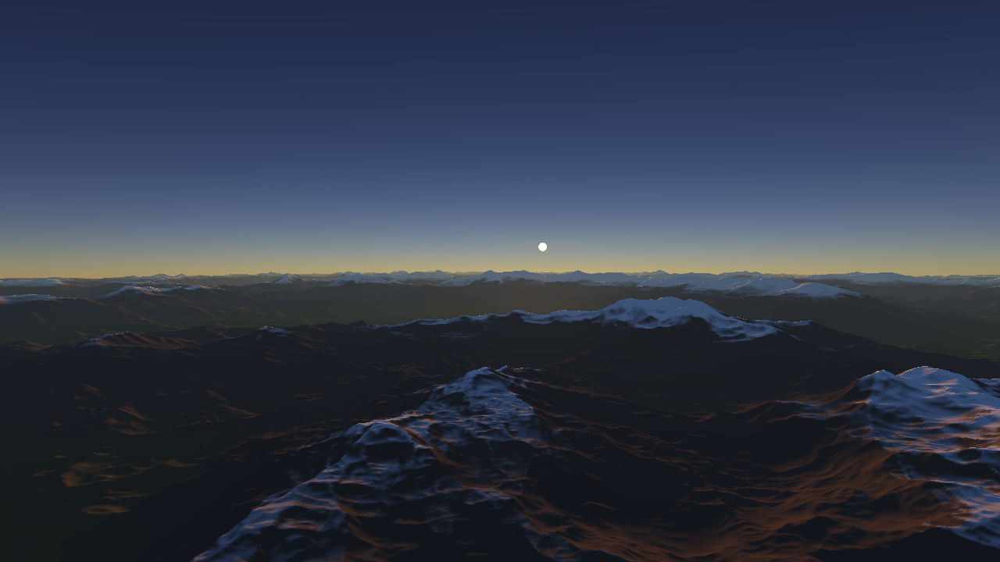
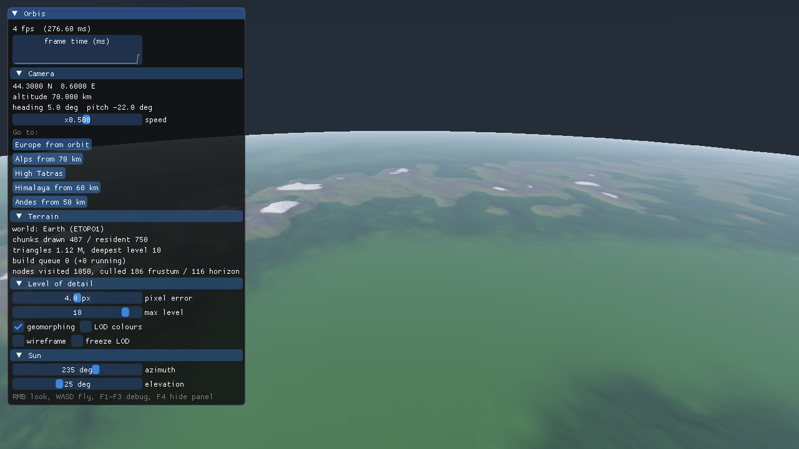
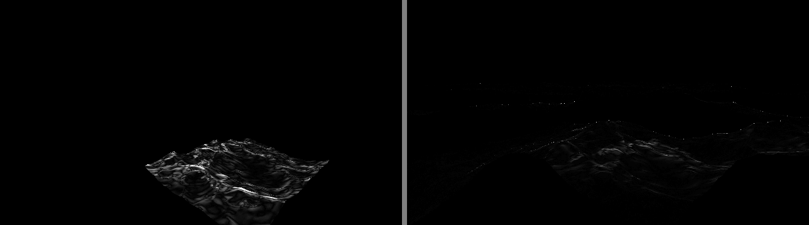
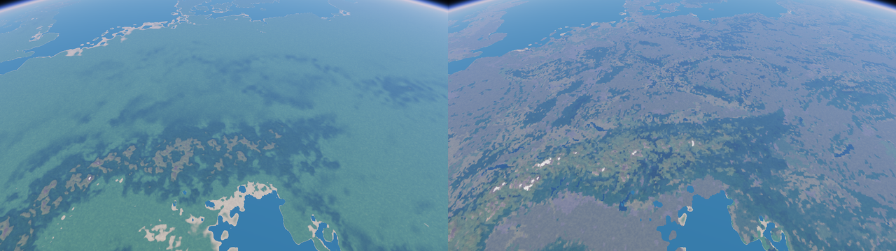
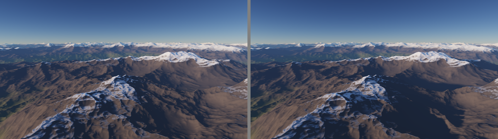

# Orbis

Planet-scale terrain renderer in C++20 and OpenGL 4.5: real Earth elevation and land cover on a
WGS84 ellipsoid, continuous LOD from orbit to the ground, streamed high-resolution tiles, a
physically based atmosphere and volumetric clouds.


| The Alps from 70 km | An Alpine valley, 2.6 km of relief |
|---|---|
|  |  |

| Procedural planet (`--world procedural`) | Quadtree levels (F3) |
|---|---|
|  |  |

| Volumetric cumulus | Above the layer: cloud shadows on MODIS land cover |
|---|---|
|  |  |

| Sunset | Debug panel |
|---|---|
|  |  |

*Frames rendered headless in CI on Mesa llvmpipe.*

## Features

### Precision and geodesy

- **Camera-relative rendering.** Positions are ECEF doubles; chunks store float vertices relative
  to their own origin and the CPU subtracts the camera in double. Sub-millimetre error up close
  (tested), against centimetres to decimetres for absolute float ECEF.
- **Reversed Z, infinite far plane**, 32-bit float depth: one depth buffer from 0.5 m to infinity.
- **WGS84**: closed-form geodetic to ECEF, an iterative inverse stable at the poles (< 1 mm
  round trip from -11 km to 10 000 km), ENU frames, terrain displaced along the geodetic vertical.

### Level of detail

- **Chunked quadtree** on a spherified cube, 18 levels (~1.2 m vertex spacing), refined by
  projected screen-space error (default 4 px). ~200 k triangles from orbit, ~2 M at ground level.
- **Selection is a pure function** of the view and the resident set. A node whose children are not
  built yet keeps being drawn, so there are no holes while data arrives.
- **Culling:** frustum, plus an exact ellipsoid horizon test in scaled space where WGS84 becomes
  the unit sphere (an inscribed sphere is 21 km too small at the equator). Bounds exist before
  meshes do and tighten to measured height ranges; tests check them against real meshes.
- **Geomorphing.** Each vertex also stores the parent surface at its position; the vertex shader
  blends by distance only, so neighbours agree on shared vertices. Measured with
  `--record-lod-only` (fixed view, moving LOD camera): **6x** fewer popping pixels on average,
  **19x** in the worst frame.
- **Skirts** hide cracks between levels. 40-byte vertices with `GL_INT_2_10_10_10_REV` normals.
- **Worker pool** for mesh generation. The queue is replaced every frame and re-prioritised by
  screen-space error, so requests the camera no longer needs are dropped unbuilt. GPU chunk cache
  with LRU eviction.



*Difference between consecutive frames at the worst LOD transition, without and with geomorphing.*

### Elevation

- **ETOPO1** (10', ice surface), converted by `tools/prepare_etopo.py` into a 4.7 MB grid. The
  converter checks the source hash and derives the grid layout from the point coordinates; known
  places (Everest, Mariana Trench, polders below sea level) are checked in tests.
- **Sampling:** Catmull-Rom (bilinear is only C0 and shows grid lines in the lighting), a
  low-passed pyramid for coarse levels, longitude wrap and pole reflection.
- **Synthetic detail below the data resolution**, starting at its Nyquist limit and scaled by a
  relief map (how far the data departs from its smoothed self), not by height: Tibet is high but
  flat. Detail never turns measured land into sea.
- **Mountains**: eroded fBm (Perlin with an analytic gradient, tested to 1e-6) at a real 8 km peak
  spacing, normalised by measured constants. Share of the area steeper than 30 degrees in the
  Valais Alps went from 0 % to 38 %; relief from 0.9 km to 3.1 km (real: ~3 km).

### High-resolution tiles

SRTM `.hgt` tiles (1 degree, 3" or 1") replace the base data and its synthetic relief. The
directory is only indexed at startup; tiles stream in around the camera under a memory budget
(`--tile-budget MB`, default 1.5 GB), so it can hold all ~14 000 tiles of global SRTM.

- **Demand from the mesh workers.** A fine sample inside an unloaded tile records a request (a
  relaxed atomic store) and returns no data. A loader thread loads the most recent request and
  publishes an immutable snapshot of the loaded set; workers cache it per thread and refresh it on
  a version change, so the hot path is one atomic load.
- **Versioned rebuilds.** Each mesh records the data version it was built from. Chunks over a
  changed tile and its feather band are rebuilt while the old mesh stays on screen.
- **Coarse LOD never depends on streaming:** tiles fade out between 400 and 800 m sample spacing.
- **Eviction** is LRU over tiles unused for 120 frames, only to admit the most wanted pending tile.
- Tests use synthetic tiles whose height is a known function of position, so swapped axes,
  mirroring, byte order and seams all show up as wrong numbers. Concurrency is tested under TSan.

| | real | ETOPO + synthetic detail |
|---|---|---|
| Matterhorn | 4478 m | 1688 m |
| Eiger north face above Grindelwald | 2933 m | -5 m |

*Why the tiles matter. `orbis --check-alps` prints these for the current data.*

### Land cover and surface materials

- **MODIS MCD12C1** (2019, IGBP classes, 0.05 degree), converted by
  `tools/prepare_landcover.py` (standard library only, own TIFF reader, georeferencing checked)
  into a 2 MB run-length file with a checksum.
- **Lakes vs sea.** MODIS has one water class. Connected components that reach water deeper than
  50 m are sea, the rest becomes inland water (181 000 cells). Labelling first keeps it to a few
  elevation samples for the whole ocean.
- Classes are an integer texture and never filtered. The shader blends the materials of the four
  surrounding cells and domain-warps the lookup, so the 5.6 km grid reads as natural boundaries.
  Altitudinal zones, snow line, cliffs and beaches come from elevation and slope.
- **Surface detail** at 256, 32, 4 and 0.5 m from one tiling 512x512 texture with analytic
  derivatives, which stay correct through the mip chain. Anchored to the world with small floats:
  the shader gets `camera mod 256 m`, computed in double. Triplanar, bump mapped by slope. 11x more
  local contrast at ground level in an Alpine meadow.



*Northern Italy from 600 km: latitude stylisation (left) and MODIS land cover (right).*

### Lighting

- **Atmosphere** after Hillaire (EGSR 2020): Rayleigh, Mie and ozone, transmittance and
  multiple-scattering LUTs built by compute shaders, per-pixel sky and aerial perspective. The
  GLSL constants are generated from the C++ model, and the GPU tables are checked against the CPU
  reference at startup (transmittance within 5e-4).
- **Sky irradiance LUT** for ambient light, validated the same way: a single-scattering build is
  compared with a CPU reference (< 0.01 %), then the real table adds multiple scattering.
- **Cascaded shadow maps** (3 x 2048), split by height above ground, snapped to texels in ECEF.
- HDR RGBA16F scene target, ACES tone mapping as a final pass.



### Volumetric clouds

- Cumulus layer from 2 to 5 km. Density is a weather cube map (noise on the sphere plus a zonal
  climatology: ITCZ, subtropical highs, storm tracks) times a height profile times tiling 3D
  Perlin-Worley noise built by a compute shader.
- Light march towards the sun, two-lobe Henyey-Greenstein phase, approximate multiple scattering,
  ambient from the sky irradiance LUT and the sunlit ground.
- **Exact aerial perspective** for a cloud at one effective depth, as a single
  `GL_ONE, GL_SRC_ALPHA` blend over the scene.
- **Wind.** The field drifts with a configurable wind; noise coordinates are
  `(eye - drift) mod tile`, computed in double, so float precision does not degrade over time.
- **Temporal reprojection.** The march runs at half resolution and traces one sub-pixel of each
  2x2 block per frame with jitter. A resolve pass reprojects the history by the cloud's own depth,
  the camera motion and the wind, clamps it to the current neighbourhood and accumulates; a
  depth-aware upsample composites it. Cloud GPU time per frame at 1280x720 dropped **3.4-4.3x** against
  the full-resolution march (measured with the pass timers), with the step noise averaged out.
- Cloud shadows on the terrain. `--clouds 0..1` sets the coverage, `--no-clouds` disables them.

### Engineering

- `orbis_core` has no OpenGL dependency. **106 Catch2 tests** (~545 000 assertions): geodesy,
  LOD bounds, mesh seams and geomorph consistency, real geography, `.hgt` parsing and streaming
  under concurrency, the atmosphere and cloud geometry.
- CI on Windows (MSVC) and Linux (GCC), Debug and Release, warnings as errors, ASan + UBSan,
  TSan, and a headless render job.
- **GPU timers** per pass (`GL_TIMESTAMP` queries, read a few frames late so nothing stalls),
  shown in the debug panel and printed after a screenshot.
- Direct State Access, immutable storage, RAII for every GL object, `KHR_debug` in debug builds.
  Dependencies pinned by version and SHA-256; shaders embedded at build time with `#line` so
  driver errors point at the right file.

## Building

CMake 3.25+, a C++20 compiler (MSVC 2022, GCC 12+, Clang 16+), OpenGL 4.5. macOS is not supported.

```bash
cmake --preset release
cmake --build --preset release
ctest --preset release
```

The executable is `build\release\src\app\Release\orbis.exe` (Visual Studio) or
`build/release/src/app/orbis` (Ninja, Makefiles). On Linux install the X11 headers first:
`sudo apt install libx11-dev libxrandr-dev libxinerama-dev libxcursor-dev libxi-dev`.

## Running

```
orbis [--world earth|procedural] [--elevation file.oeg] [--hgt dir [--tile-budget MB]]
      [--check-alps] [--size WxH]
      [--landcover file.olc | --no-landcover]
      [--view lat,lon,altKm,heading,pitch [--above-ground]] [--sun azimuth,elevation]
      [--fov degrees] [--lod-colors] [--no-geomorph] [--no-shadows] [--no-detail]
      [--clouds coverage | --no-clouds]
      [--screenshot file.ppm [--show-ui] [--record frames,metres [--record-lod-only]]]
```

| Input | Action |
|---|---|
| Right mouse + move | Look around |
| W A S D | Fly |
| Space / E, Ctrl / Q | Up / down |
| Shift | 4x speed |
| Mouse wheel | Speed multiplier |
| `[` / `]` | Pixel error |
| F1 | Wireframe |
| F2 | Freeze LOD |
| F3 | Colour by quadtree level |
| F4 | Debug panel |
| Esc | Quit |

```
orbis                                                   # Europe from orbit
orbis --view 44.3,8.6,70,5,-22 --sun 235,25             # the Alps from 70 km
orbis --view 45.982,7.635,0.15,90,7.6 --above-ground    # an Alpine valley
orbis --view 49.213,19.990,0.15,225,6 --above-ground    # a Tatra valley
orbis --world procedural --view 0.30,-140.75,6.5,45,-10 # procedural mountains
```

Data files are looked up in `data/` next to the executable, then in the source tree. See
[data/HGT_README.md](data/HGT_README.md) for high-resolution tiles.

## Layout

```
src/core/      no GPU dependency
  math/        Vec3, Mat4, Frustum
  geo/         WGS84, ENU, horizon culling
  terrain/     cube sphere, noise, elevation sources, .hgt tiles and streaming, land cover,
               chunk meshes, quadtree LOD, worker pool
  scene/       camera
  atmosphere/  atmosphere and cloud models, GLSL constant generation
src/app/       window, renderer passes, GPU cache, debug panel, GL wrappers
shaders/       GLSL, embedded at build time
data/          ETOPO grid, MODIS land cover, optional hgt/
tools/         data preparation
tests/         Catch2
```

## Roadmap

- [x] WGS84, cube sphere, camera-relative rendering, reversed Z, CI
- [x] Quadtree LOD, horizon culling, skirts, worker pool, GPU cache
- [x] ETOPO1 with bicubic and mip-filtered sampling, relief-driven synthetic detail
- [x] MODIS land cover, lakes separated from the sea
- [x] Geomorphing, ImGui panel, LOD recording
- [x] Hillaire atmosphere, sky irradiance LUT, GPU/CPU validation
- [x] Eroded fBm mountains, cascaded shadows
- [x] `.hgt` tiles streamed under a memory budget
- [x] Surface detail and material blending
- [x] Volumetric clouds, HDR pipeline
- [x] Cloud wind and temporal reprojection, GPU pass timers
- [ ] ETOPO 2022 (1') base layer, seasonal land cover

## References

- S. Hillaire, *A Scalable and Production Ready Sky and Atmosphere Rendering Technique*, EGSR 2020.
- E. Bruneton, F. Neyret, *Precomputed Atmospheric Scattering*, 2008.
- T. Ulrich, *Rendering Massive Terrains using Chunked Level of Detail Control*, SIGGRAPH 2002.
- P. Cozzi, K. Ring, *3D Engine Design for Virtual Globes*, 2011.
- A. Schneider, *The Real-time Volumetric Cloudscapes of Horizon Zero Dawn*, SIGGRAPH 2015.
- M. Wrenninge et al., *Oz: The Great and Volumetric*, SIGGRAPH 2013 (multiple scattering).
- B. Karis, *High Quality Temporal Supersampling*, SIGGRAPH 2014.
- N. Reed, *Depth Precision Visualized*.
- K. Perlin, *Improving Noise*, 2002. F. K. Musgrave, ridged multifractals. I. Quilez, analytic
  noise derivatives.
- NIMA TR8350.2, *World Geodetic System 1984*.
- NOAA NCEI, ETOPO1 (doi:10.7289/V5C8276M). M. Friedl, D. Sulla-Menashe, MODIS MCD12C1
  (doi:10.5067/MODIS/MCD12C1.006). J. de Ferranti, viewfinderpanoramas.org. NASA/USGS, SRTM.
- O. Cornut, Dear ImGui.
