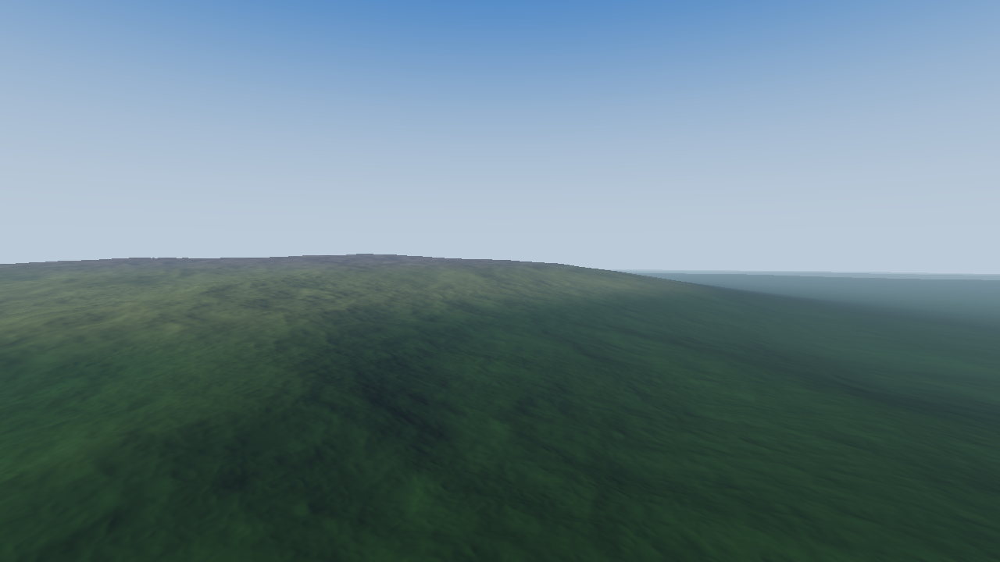
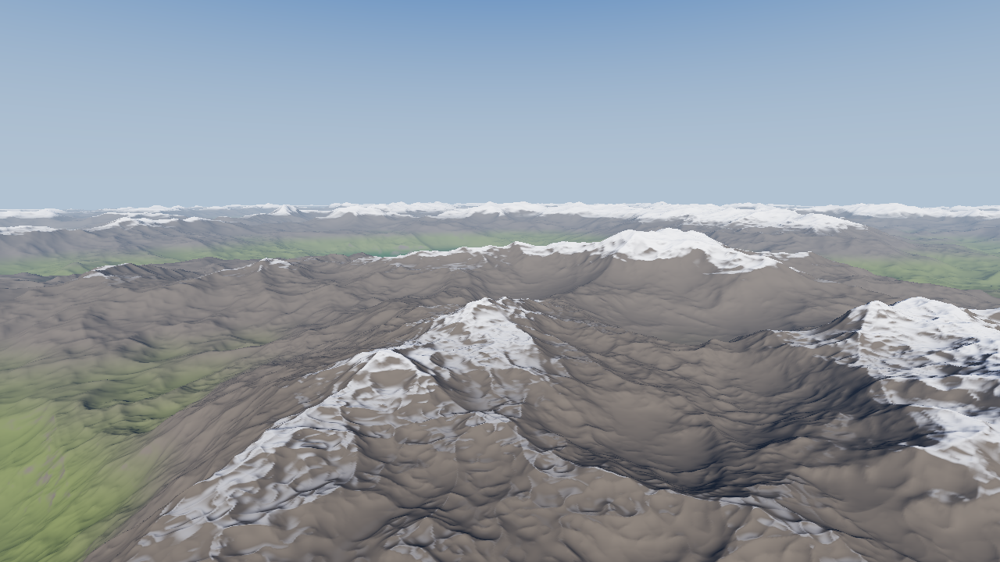
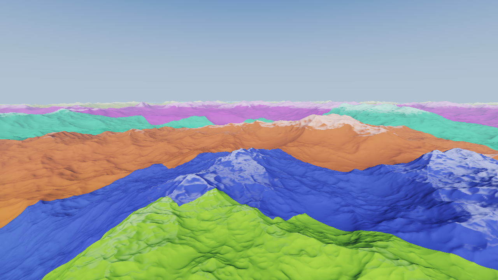

# Orbis — planet-scale terrain renderer

A whole-planet terrain renderer in modern C++20 and OpenGL 4.5, built around the problems real
geospatial and military simulators have to solve: **real Earth elevation data on a WGS84 ellipsoid,
planetary coordinate precision, continuous level of detail from orbit to the ground, culling at
planetary scale, and streaming terrain generation on worker threads.**


| The Alpine arc from 70 km (real data + synthetic detail) | High Tatras from the south |
|---|---|
|  |  |

| Procedural planet (`--world procedural`) | Quadtree LOD levels (debug view, F3) |
|---|---|
|  |  |

*All frames rendered headless in CI with Mesa's software OpenGL (llvmpipe).*

## Highlights

### Real Earth

**Measured elevation.** NOAA ETOPO1 (ice surface, 10 arc-minutes ≈ 18 km), converted by
`tools/prepare_etopo.py` into a 4.7 MB grid that ships with the repository. The converter verifies
the source by SHA-256 and recovers the grid layout from the point coordinates instead of assuming
it — the source turned out to start at Greenwich, not at −180°, which a check against known
places (Everest, Mariana Trench, Košice, the Netherlands' polders below sea level) caught.

**Sampling done properly.** Bicubic (Catmull-Rom) interpolation, because bilinear is only C0 and
every grid line would show as a lighting crease below the data resolution. A low-passed mip
pyramid so coarse LOD levels read pre-filtered data instead of aliasing. Rows beyond a pole
continue on the opposite meridian and longitude wraps, so the poles and the date line are not edges.

**Synthetic detail below the data resolution** — the standard simulator approach of "measured base,
plausible detail". The detail starts exactly at the data's Nyquist limit, and its strength comes
from a precomputed *relief map* (how much the data deviates from its own smoothed version): ~5 m on
plains, ~300 m in the Tatras, ~700 m in the Alps. Absolute height would be a poor guide — the
Tibetan plateau is high but flat. Where the data says land, detail may not create sea (otherwise
every lowland fills with puddles); the other way round gives natural fractal coastlines.

**One interface, two worlds.** Quadtree, mesh builder and worker threads only see
`ElevationSource`; `--world earth|procedural` switches between ETOPO and the procedural planet.

*Honest limits:* 18 km data shows real mountain ranges from altitude, but foothills rather than
peaks from the ground — that needs higher-resolution tiles (see roadmap). Land cover is a
latitude/elevation stylisation (arid subtropical belts, temperate forest, taiga, tundra, tree, rock
and snow lines fitted to real references), so e.g. monsoon Nepal comes out arid.

### Level of detail

**Chunked quadtree LOD with screen-space error.** Each of the 6 cube faces is a quadtree, down to
level 18 (~1.2 m between vertices). A node is refined when its vertex spacing, projected onto the
screen at the node's nearest point, exceeds a pixel budget (default 4 px, `[` / `]` to change). The
result: ~200 k triangles for the whole planet from orbit, ~2 M triangles at ground level with
detail from the foreground to the horizon.

**Selection is a pure function** of the view and of which chunks are resident — no hidden state,
fully unit-tested. If the children of a node are not ready yet, the coarser node keeps being drawn
and the children are requested: the image never has holes, it sharpens as data arrives.

**Tight bounds.** Culling needs bounding volumes *before* a mesh exists. Bounds start conservative
(0 – 11 km of terrain) and tighten to the real height range of each mesh once it is built; a
not-yet-built child inherits its parent's *subtree* range. Tests check these bounds against real
meshes. (Loose bounds were caught by a test: they inflated a ground-level view from ~1 000 to
~24 000 chunks.)

**Frustum culling + exact ellipsoid horizon culling.** The horizon test runs in ellipsoid-scaled
space, where WGS84 becomes the unit sphere and lines of sight stay straight, so the horizon is the
real one — an inscribed sphere would be 21 km too small at the equator and keep hundreds of
invisible chunks alive.

**Skirts against LOD cracks.** Neighbouring chunks at different levels do not share vertices; each
chunk has a skirt hanging below its border, wound to face outwards, so a crack shows terrain-coloured
skirt instead of sky.

### Streaming

**Background mesh generation.** A thread pool builds chunk meshes; the main thread only uploads
finished ones (bounded per frame, no hitches). The request queue is *replaced* every frame rather
than appended to: requests the moving camera no longer needs are dropped before anyone wastes time
on them, the rest is re-prioritised by screen-space error. Shutdown is immediate even with
thousands of queued requests (a test caught it draining the whole queue first).

**GPU chunk cache** with time-based and LRU eviction (bounded memory; chunks drawn this frame are
never evicted).

### Precision and geodesy

**Camera-relative rendering.** A 32-bit float has ~7 significant digits: at Earth-radius distances
its resolution is ~0.5 m, which shows up as shaking vertices. World positions stay in `double`
(ECEF); each chunk stores `float` vertices relative to its own origin; per frame the CPU computes
`chunkOrigin − cameraPosition` in double. The GPU only ever sees small numbers.

**Reversed-Z with an infinite far plane.** One depth buffer from 0.5 m to infinity:
`glClipControl(GL_ZERO_TO_ONE)` + 32-bit float depth + a projection mapping near → 1, ∞ → 0.

**WGS84.** Exact geodetic → ECEF, an iterative inverse stable at the poles (< 1 mm round-trip error
from −11 km to 10 000 km altitude), ENU frames, terrain displaced along the geodetic vertical.

### Terrain

**Spherified cube** (cell areas within 4/3 of each other instead of 5.2× for naive normalisation;
face edges bit-identical, tested). **Procedural planet**: band-limited continents, ridged-multifractal
mountain ranges and fractal detail down to ~1 m, sampled on the unit sphere (no pole stretching, no
date-line seam). Octaves finer than a chunk can represent are faded out (Nyquist), so coarse levels
do not alias, and the normalisation keeps the large-scale shape identical across levels.
**Deterministic** across compilers (own PRNG instead of `std::shuffle`). **Seamless normals**
computed from the height field around each vertex's direction, bit-identical across chunk borders.

### Rendering

Sky pass sharing its atmosphere functions with the terrain haze (distant mountains fade into the
sky behind them); haze based on the *air path length*, so orbit views get a light tint and
ground-level views get real aerial perspective; ACES filmic tone mapping; sun disk and dusk colours.

### Engineering

- `orbis_core` has no OpenGL or windowing dependency: math, geodesy, terrain, LOD and the thread
  pool are all unit-tested — **66 Catch2 tests**, ~459 000 assertions, including checks against
  known geography.
- CI: Windows (MSVC) + Linux (GCC), Debug + Release, warnings as errors
  (`/W4`, `-Wall -Wextra -Wpedantic -Wconversion -Wsign-conversion -Wdouble-promotion ...`),
  **AddressSanitizer + UBSan**, **ThreadSanitizer**, and a headless render job that uploads frames.
- Dependencies pinned by version **and** SHA-256; shaders embedded at build time, shared GLSL with
  `#line` so compiler errors point at the right line.
- Modern OpenGL: Direct State Access, immutable buffer storage, RAII ownership of every GL object,
  `KHR_debug` output in debug builds; member order guarantees GL objects die before the context and
  worker threads join before the data they read.

## Building

Requirements: CMake ≥ 3.25, a C++20 compiler (MSVC 2022, GCC 12+, Clang 16+), a GPU with
OpenGL 4.5. macOS is not supported (Apple stops at OpenGL 4.1).

```bash
cmake --preset release
cmake --build --preset release
ctest --preset release
```

These commands **build and test**; they do not start the program. Run it from:

| Generator | Executable |
|---|---|
| Visual Studio (Windows default) | `build\release\src\app\Release\orbis.exe` |
| Ninja / Makefiles | `build/release/src/app/orbis` |

In Visual Studio you can instead *Open Folder*, pick the `release` preset and `orbis.exe` as the
startup item, and press F5. On Linux install the X11 headers first:
`sudo apt install libx11-dev libxrandr-dev libxinerama-dev libxcursor-dev libxi-dev`.

## Running

```
orbis [--world earth|procedural] [--elevation file.oeg] [--size WxH]
      [--view lat,lon,altKm,heading,pitch] [--sun azimuth,elevation]
      [--lod-colors] [--screenshot file.ppm]
```

| Input | Action |
|---|---|
| Right mouse + move | Look around |
| W A S D | Fly |
| Space / E, Ctrl / Q | Up / down along the local vertical |
| Shift | 4× speed |
| Mouse wheel | Speed multiplier (speed also scales with altitude) |
| `[` / `]` | More / less detail (pixel error) |
| F1 | Wireframe |
| F2 | Freeze LOD — keep the selection of this moment and fly around it to watch culling |
| F3 | Colour chunks by quadtree level |
| Esc | Quit |

The window title shows FPS, altitude, position, chunks and triangles drawn, deepest level and the
build queue. Places to start:

```
orbis                                                   # Europe from orbit, above Kosice
orbis --view 44.3,8.6,70,5,-22 --sun 235,25             # the Alps from 70 km
orbis --view 48.95,20.10,2.6,8,-3 --sun 250,16          # the High Tatras
orbis --world procedural --view 0.30,-140.75,6.5,45,-10 # procedural mountains
```

The Earth data is looked up next to the executable (`data/`, copied there by the build) and then
in the source tree; `--elevation` points to another `.oeg` file.

## Project layout

```
src/core/      engine core, no GPU dependency
  math/        Vec3, Mat4 (reversed-Z projection), Frustum
  geo/         WGS84 ellipsoid, geodetic <-> ECEF, ENU frames, horizon culling
  terrain/     cube-sphere, noise, elevation sources (ETOPO grid, procedural), chunk meshes +
               skirts, quadtree LOD, thread pool
  scene/       ENU flight camera
src/app/       window, terrain streaming + GPU cache, sky, OpenGL wrappers, application loop
shaders/       GLSL, embedded into the executable at build time
data/          earth_etopo10.oeg - ETOPO1 elevation grid (generated by tools/prepare_etopo.py)
tools/         data preparation scripts
tests/         Catch2 unit tests
```

## Roadmap

- [x] **Foundation:** WGS84, cube-sphere, camera-relative rendering, reversed-Z, tests, CI.
- [x] **LOD and streaming:** quadtree with screen-space error, frustum + ellipsoid horizon culling,
      skirts, worker-thread generation with a re-prioritised queue, GPU cache with eviction.
- [x] **Real Earth:** ETOPO1 elevation, bicubic + mip-filtered sampling, relief-driven synthetic
      detail, `ElevationSource` interface.
- [ ] **High-resolution tiles:** stream regional DEM tiles (ETOPO 2022 1′, SRTM) on demand.
- [ ] **Land cover data** instead of the latitude stylisation.
- [ ] **Smooth transitions:** geomorphing between LOD levels; ImGui debug panel; physically based
      atmospheric scattering.

## References

- NOAA NCEI — *ETOPO1 1 Arc-Minute Global Relief Model* (doi:10.7289/V5C8276M), public domain;
  10′ resampling from the PyVista example-data repository.
- NIMA TR8350.2 — *Department of Defense World Geodetic System 1984*.
- P. Cozzi, K. Ring — *3D Engine Design for Virtual Globes* (2011).
- T. Ulrich — *Rendering Massive Terrains using Chunked Level of Detail Control* (SIGGRAPH 2002).
- K. Perlin — *Improving Noise* (2002); F. K. Musgrave — *Texturing and Modeling: A Procedural
  Approach*, ch. on ridged multifractals.
- N. Reed — *Depth Precision Visualized* (reversed-Z).
