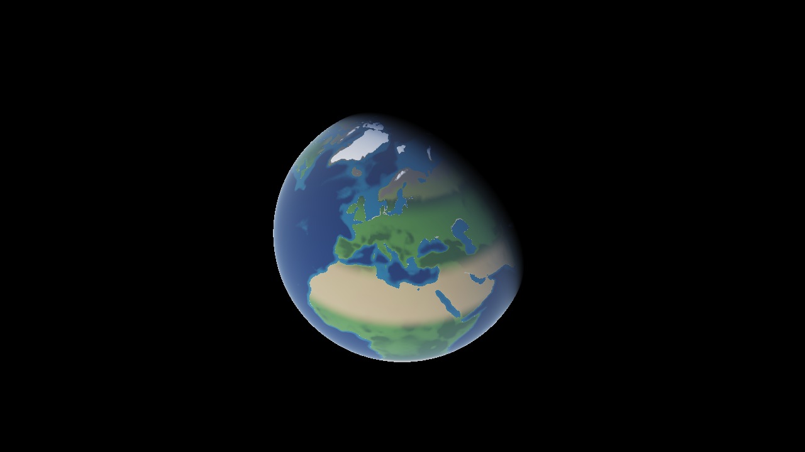
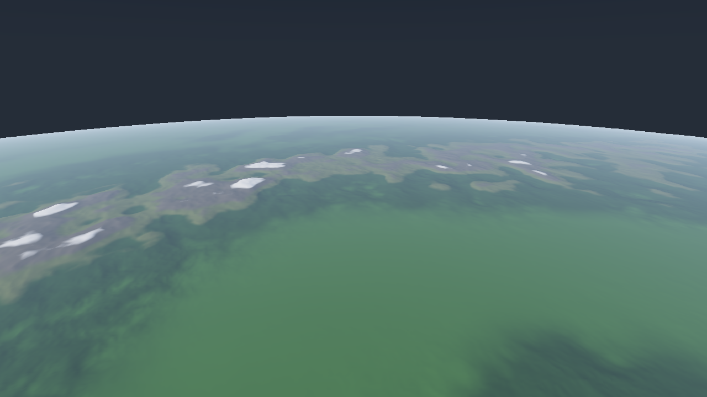
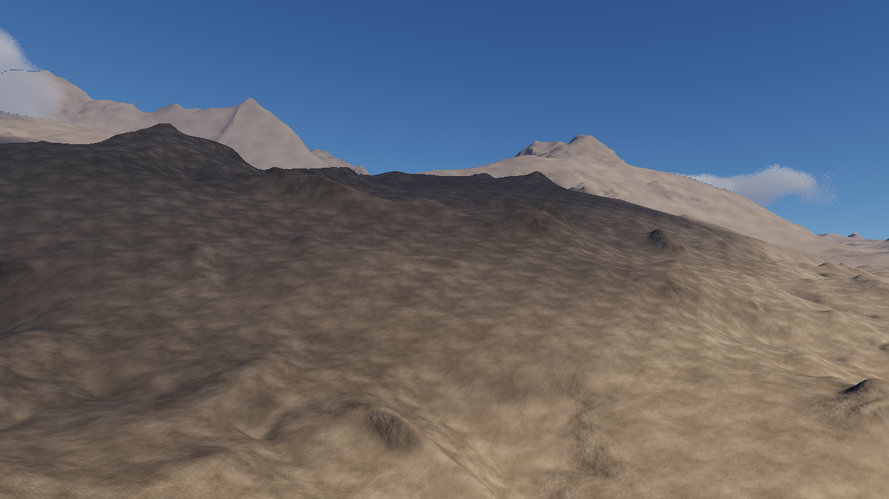
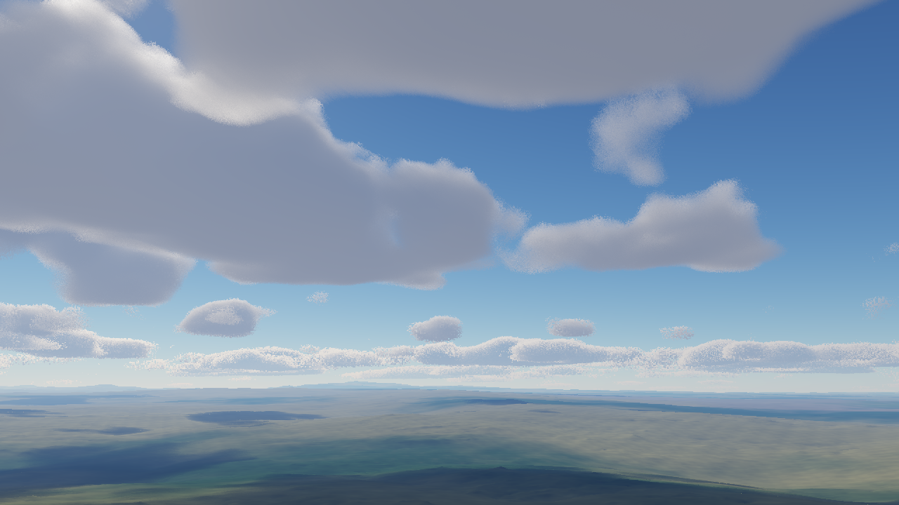
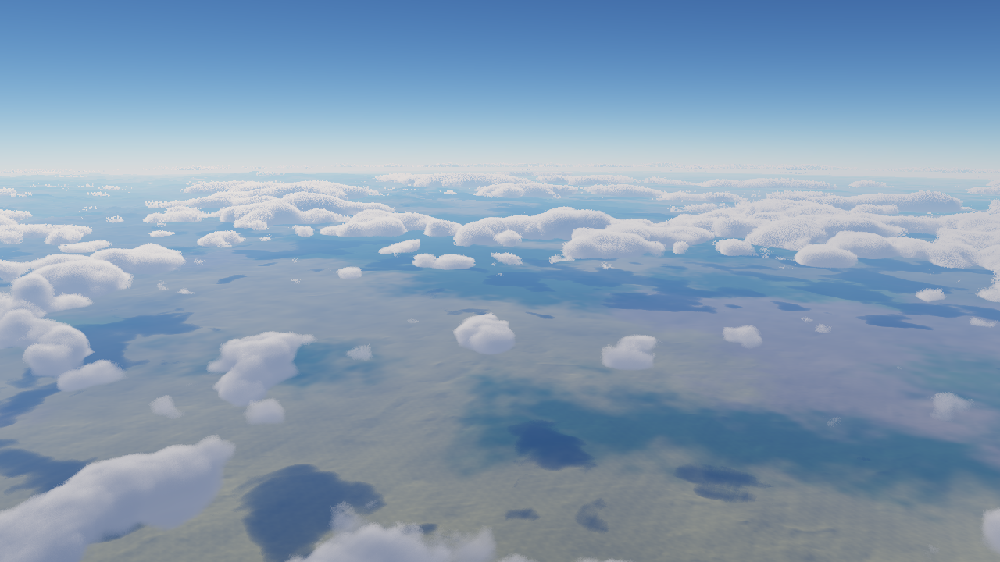
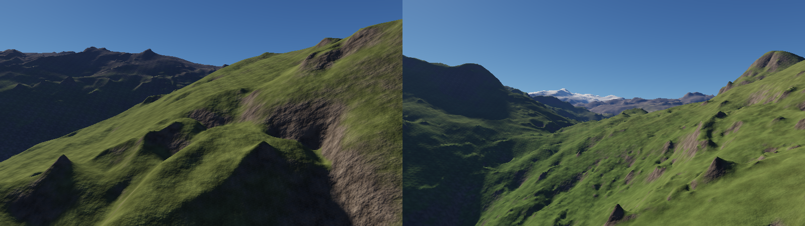
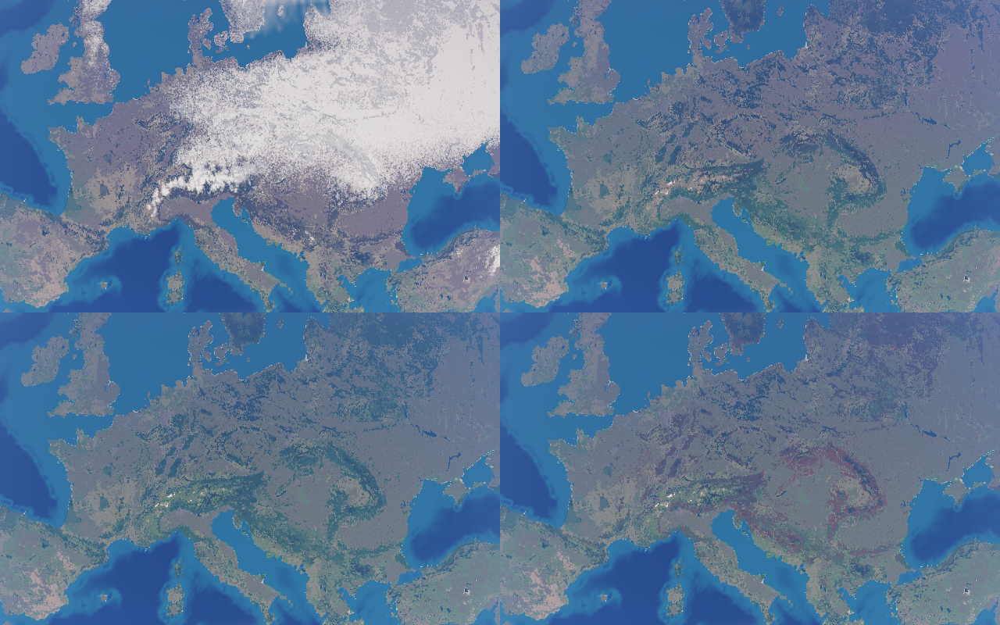

# Orbis

A planet-scale terrain renderer written in C++20 and OpenGL 4.5. It draws the whole Earth on the
WGS84 ellipsoid from real elevation and land cover data, with continuous level of detail from
orbit down to a few metres above the ground.



| The Alps from 70 km | Alpine valley |
|---|---|
|  |  |

| Volumetric clouds | Cloud shadows on MODIS land cover |
|---|---|
|  |  |

All screenshots are rendered headless in CI (Mesa llvmpipe).

## What's in it

**Coordinates.** World positions are ECEF doubles. Each terrain chunk stores float vertices
relative to its own origin and the camera offset is subtracted in double on the CPU, so precision
stays below a millimetre near the camera. Reversed Z with an infinite far plane covers 0.5 m to
the horizon with one depth buffer.

**Level of detail.** A quadtree on each face of a spherified cube, refined by screen-space error,
down to about 1.2 m between vertices. Meshes are built on a worker pool whose queue is
re-prioritised every frame, culled by frustum and by an exact ellipsoid horizon test, and
geomorphed between levels so nothing pops (measured 6x fewer changed pixels per frame).

**Elevation.** ETOPO1 at 10' ships with the repo. ETOPO 2022 at 1' (233 M nodes) is used when you
generate it locally, see [Data](#data). It is stored as int16 with a filtered mip pyramid, about
620 MB, and loads in 2 s. Below the data resolution the terrain gets synthetic detail scaled by
local relief, so the Netherlands stay flat and the Alps don't.

| `--check-alps` | real | ETOPO1 10' | ETOPO 2022 1' |
|---|---|---|---|
| Mont Blanc | 4808 m | 3645 m | 4403 m |
| Matterhorn | 4478 m | 1777 m | 3438 m |
| Grindelwald (valley floor) | 1034 m | 3368 m | 840 m |

SRTM `.hgt` tiles can be added on top. They are streamed around the camera on a background
thread under a memory budget; readers never take a lock, and chunks over a newly loaded tile are
rebuilt while the old ones stay on screen.



*Above Zermatt: 10' data with synthetic relief (left), 1' data (right).*

**Land cover and seasons.** MODIS IGBP classes (0.05 degree) decide the surface material, with
lakes separated from the sea. A small climate model gives the monthly mean temperature from
latitude, day of year, height and how much sea lies upwind; it was fitted to 40 weather stations
(median error 2.4 C). It drives leaf colour, dry grass, snow cover, frozen lakes and sea ice.
`--date MM-DD` picks the day.



*Central Europe in January, April, July and October.*

**Atmosphere and clouds.** The sky and aerial perspective follow Hillaire (2020), with lookup
tables built by compute shaders and checked against a CPU reference at startup. Clouds are ray
marched at half resolution and accumulated over frames with reprojection, which made them about
4x cheaper. They drift with the wind and cast shadows on the terrain. Sun shadows use three
cascades.

**Testing.** The core library has no OpenGL dependency and is covered by 115 Catch2 tests. CI
builds on Windows (MSVC) and Linux (GCC) with warnings as errors, runs the tests under ASan,
UBSan and TSan, and renders the screenshots above.

## Building

You need CMake 3.25+, a C++20 compiler (MSVC 2022, GCC 12+ or Clang 16+) and a GPU with OpenGL
4.5. macOS is not supported.

```bash
cmake --preset release
cmake --build --preset release
ctest --preset release
```

On Linux install the X11 headers first:
`sudo apt install libx11-dev libxrandr-dev libxinerama-dev libxcursor-dev libxi-dev`.

## Running

```
orbis                                                   # Europe from orbit
orbis --view 44.3,8.6,70,5,-22 --sun 235,25             # the Alps from 70 km
orbis --view 45.982,7.635,0.15,90,7.6 --above-ground    # an Alpine valley
orbis --date 01-15 --view 46.3,7.0,60,120,-25           # the Alps in winter
orbis --world procedural                                # a procedural planet
```

`orbis --help` lists every option. Right mouse button looks around, WASD flies, Shift is faster,
the mouse wheel changes speed, F1 to F3 toggle wireframe, LOD freeze and LOD colours, F4 hides
the debug panel.

## Data

`data/` contains ETOPO1 and the MODIS land cover. For the 1' base layer, download
`ETOPO_2022_v1_60s_N90W180_surface.tif` from
[NOAA](https://www.ncei.noaa.gov/products/etopo-global-relief-model) and run:

```bash
python tools/prepare_etopo2022.py ETOPO_2022_v1_60s_N90W180_surface.tif
```

For high-resolution tiles see [data/HGT_README.md](data/HGT_README.md).

## References

- S. Hillaire, *A Scalable and Production Ready Sky and Atmosphere Rendering Technique*, 2020
- T. Ulrich, *Rendering Massive Terrains using Chunked Level of Detail Control*, 2002
- P. Cozzi, K. Ring, *3D Engine Design for Virtual Globes*, 2011
- A. Schneider, *The Real-time Volumetric Cloudscapes of Horizon Zero Dawn*, 2015
- NOAA ETOPO1 and ETOPO 2022, NASA MODIS MCD12C1, NASA/USGS SRTM
